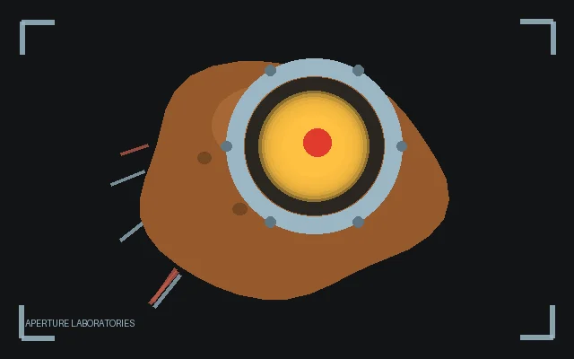

# GLaDOS

<p align="center">
  
</p>

GLaDOS, the Aperture Science AI, now runs your smart home. A [Kiosk Satellite](https://github.com/jxlarrea/kiosk-satellite) plugin that adds the **GLaDOS** skin to Voice Satellite.

The skin draws the turn itself: the Aperture eye — a chrome ring, a dark lens and a glowing core that flares with your voice and the answer — inside a HUD of bracket corners, drifting scan lines and orbiting tick marks, with the conversation below and a GLaDOS-flavored status caption (`THINKING. IT IS HARDER THAN IT LOOKS.`).

- **Full screen**: the eye and HUD fill the top half, the conversation the bottom.
- **Docked**: a dark Aperture card at the bottom with a small eye beside the words.
- Iconic Portal lines in English rotate while the skin waits: **THE CAKE IS A LIE.** · **STILL ALIVE.** · **WE DO WHAT WE MUST BECAUSE WE CAN.** · **THE ENRICHMENT CENTER IS MANDATORY.** · **SCIENCE ISN'T ABOUT WHY, IT'S ABOUT WHY NOT.** · **THIS WAS A TRIUMPH.**
- Follows Voice Satellite's **Appearance** settings: Theme, Background, Text size and Reactive activity bar.
- Six shutter blades tighten around the core while the assistant thinks.
- With **Reactive activity bar** off, nothing moves with the voice; the eye only breathes.

## Installation

### Community Plugins

If listed in [Community Plugins](https://kiosksatellite.com/plugins/), search for `GLaDOS` in **Settings > Plugin Manager > Browse plugins** in Kiosk Satellite.

### Manual

1. Open **Settings > Plugin Manager** in Kiosk Satellite and turn on **Enable Plugins**.
2. Choose **Add plugin**, paste this repository's GitHub URL and choose **Preview**.
3. Review the plugin and choose **Trust and install**.

## Configuration

1. Open **Settings > Plugin Manager** and ensure the GLaDOS plugin is enabled.
2. Pick **GLaDOS** in **Voice Satellite > Appearance > Skin**.
3. Configure Voice Satellite as you would any other built-in skin. **Preview** shows the skin for five seconds.

If the plugin is disabled, stops or is uninstalled, Kiosk Satellite draws its own skin until the plugin runs again. The pick stays saved.

## Building from source

You need Python 3, JDK 17 or newer and an Android SDK with build-tools and at least one platform. This repo holds only the plugin's own source, so the build tool and SDK interfaces come from the [plugin template](https://github.com/jxlarrea/kiosk-satellite-plugin-hello-world). Keep them in an untracked `.build-kit/` folder, which `.gitignore` already excludes.

```sh
git clone <this repository> && cd <this repository>
# Fetch the template's build tool and SDK interfaces into .build-kit/
git clone --depth 1 https://github.com/jxlarrea/kiosk-satellite-plugin-hello-world /tmp/ks-plugin-template
mkdir .build-kit && cp -r /tmp/ks-plugin-template/tools /tmp/ks-plugin-template/sdk .build-kit/
# Build
export ANDROID_HOME=/path/to/android-sdk   # an absolute path, not ~
python3 .build-kit/tools/build.py .
```

The ZIP and its `.sha256` are written to `dist/`.

- `--android-platform <version>` picks an installed platform. The default is the highest installed.
- `--version 1.2.3` overrides the version in `kiosk-satellite-plugin.json`.

To run the lifecycle test against the Android stubs:

```sh
PLATFORM=$ANDROID_HOME/platforms/android-24/android.jar
javac --release 8 -cp $PLATFORM -d /tmp/glados-test $(find .build-kit/sdk/src src tests -name '*.java')
java -ea -cp /tmp/glados-test:$PLATFORM glados.kiosk.skin.GladosSkinTest
```

For developer testing only, use **Plugin Manager > Developer Tools > Install from ZIP** on the kiosk or remote admin.

## License

MIT. Portal, GLaDOS and Aperture Science are Valve's; this is a fan-made tribute.
